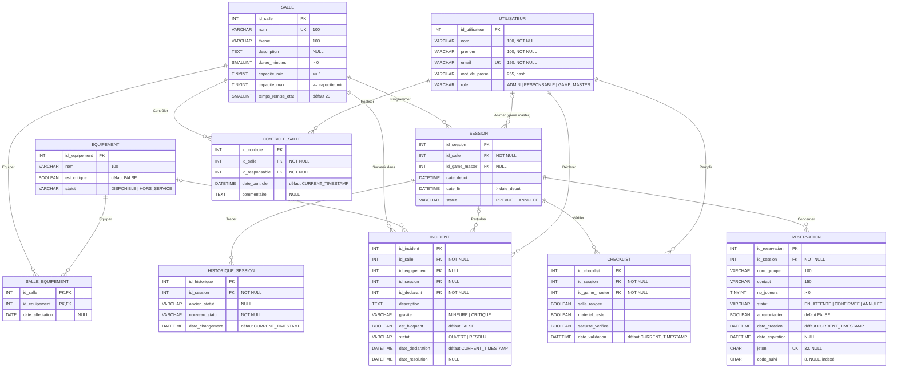

# MLD — EscapeOps

Modèle logique de données (relationnel) issu du MCD (`MCD_EscapeOps.svg`, version « après Mes réservations »).
Source de vérité : les migrations `starter-kit/database/migrations/` (001 schéma, 002 vues, 003 procédure, 004 trigger).
SGBD : MySQL 8.4, moteur InnoDB, jeu de caractères `utf8mb4`.

Conventions de notation :

- **clé primaire** en gras (soulignée dans la notation Merise) ;
- `#clé_étrangère` préfixée par `#` ;
- une clé à la fois primaire et étrangère est en gras **et** préfixée par `#`.

---

## 1. Schéma relationnel (notation textuelle)

- **UTILISATEUR** (**id_utilisateur**, nom, prenom, email, mot_de_passe, role)
- **SALLE** (**id_salle**, nom, theme, description, duree_minutes, capacite_min, capacite_max, temps_remise_etat)
- **EQUIPEMENT** (**id_equipement**, nom, est_critique, statut)
- **SALLE_EQUIPEMENT** (**#id_salle**, **#id_equipement**, date_affectation)
- **SESSION** (**id_session**, #id_salle, #id_game_master, date_debut, date_fin, statut)
- **RESERVATION** (**id_reservation**, #id_session, nom_groupe, contact, nb_joueurs, statut, a_recontacter, date_creation, date_expiration, jeton, code_suivi)
- **INCIDENT** (**id_incident**, #id_salle, #id_equipement, #id_session, #id_declarant, description, gravite, est_bloquant, statut, date_declaration, date_resolution)
- **CHECKLIST** (**id_checklist**, #id_session, #id_game_master, salle_rangee, materiel_teste, securite_verifiee, date_validation)
- **HISTORIQUE_SESSION** (**id_historique**, #id_session, ancien_statut, nouveau_statut, date_changement)
- **CONTROLE_SALLE** (**id_controle**, #id_salle, #id_responsable, date_controle, commentaire)

Références des clés étrangères :

| Clé étrangère | Référence |
|---|---|
| SALLE_EQUIPEMENT.id_salle | SALLE.id_salle |
| SALLE_EQUIPEMENT.id_equipement | EQUIPEMENT.id_equipement |
| SESSION.id_salle | SALLE.id_salle |
| SESSION.id_game_master | UTILISATEUR.id_utilisateur |
| RESERVATION.id_session | SESSION.id_session |
| INCIDENT.id_salle | SALLE.id_salle |
| INCIDENT.id_equipement | EQUIPEMENT.id_equipement |
| INCIDENT.id_session | SESSION.id_session |
| INCIDENT.id_declarant | UTILISATEUR.id_utilisateur |
| CHECKLIST.id_session | SESSION.id_session |
| CHECKLIST.id_game_master | UTILISATEUR.id_utilisateur |
| HISTORIQUE_SESSION.id_session | SESSION.id_session |
| CONTROLE_SALLE.id_salle | SALLE.id_salle |
| CONTROLE_SALLE.id_responsable | UTILISATEUR.id_utilisateur |

Toutes les clés primaires simples sont des `INT UNSIGNED AUTO_INCREMENT` ; la seule clé composée est celle de `salle_equipement`.

---

## 2. Diagramme (Mermaid)

Types abrégés (Mermaid n'accepte pas d'espace dans un type) : `INT` = `INT UNSIGNED`, `TINYINT`/`SMALLINT` = non signés.
Lecture des cardinalités : `||` exactement un, `|o` zéro ou un, `o{` zéro ou plusieurs.

---

## 3. Contraintes

### 3.1 Clés étrangères

| Contrainte | Colonne → référence | NULL ? | ON DELETE | Effet |
|---|---|---|---|---|
| `fk_se_salle` | salle_equipement.id_salle → salle | non | CASCADE | supprimer une salle retire ses affectations d'équipement |
| `fk_se_equipement` | salle_equipement.id_equipement → equipement | non | CASCADE | supprimer un équipement retire ses affectations |
| `fk_session_salle` | session.id_salle → salle | non | (défaut : RESTRICT) | impossible de supprimer une salle qui a des sessions |
| `fk_session_game_master` | session.id_game_master → utilisateur | oui | SET NULL | supprimer un game master « désaffecte » ses sessions |
| `fk_reservation_session` | reservation.id_session → session | non | (défaut : RESTRICT) | impossible de supprimer une session réservée |
| `fk_incident_salle` | incident.id_salle → salle | non | (défaut : RESTRICT) | l'historique d'incidents protège la salle |
| `fk_incident_equipement` | incident.id_equipement → equipement | oui | SET NULL | l'incident reste, sans équipement |
| `fk_incident_session` | incident.id_session → session | oui | SET NULL | l'incident reste, sans session |
| `fk_incident_declarant` | incident.id_declarant → utilisateur | non | (défaut : RESTRICT) | le déclarant ne peut pas être supprimé |
| `fk_checklist_session` | checklist.id_session → session | non | CASCADE | la checklist disparaît avec sa session |
| `fk_checklist_game_master` | checklist.id_game_master → utilisateur | non | (défaut : RESTRICT) | |
| `fk_historique_session` | historique_session.id_session → session | non | CASCADE | l'historique disparaît avec sa session |
| `fk_controle_salle` | controle_salle.id_salle → salle | non | CASCADE | les contrôles disparaissent avec la salle |
| `fk_controle_responsable` | controle_salle.id_responsable → utilisateur | non | (défaut : RESTRICT) | |

Aucune clé étrangère ne précise `ON UPDATE` (défaut : RESTRICT ; les clés sont des auto-incréments jamais modifiés).

### 3.2 Unicité

| Contrainte | Table | Colonne(s) |
|---|---|---|
| PRIMARY KEY composée | salle_equipement | (id_salle, id_equipement) — un équipement n'est affecté qu'une fois à une même salle |
| `uq_utilisateur_email` | utilisateur | email (identifiant de connexion) |
| `uq_salle_nom` | salle | nom |
| `uq_reservation_jeton` | reservation | jeton (lien secret de confirmation / annulation ; plusieurs NULL autorisés) |

### 3.3 CHECK (domaines et statuts)

Les statuts sont des `VARCHAR(20)` contraints par `CHECK … IN (…)` (pas de type `ENUM`).

| Contrainte | Table | Règle |
|---|---|---|
| `ck_utilisateur_role` | utilisateur | role ∈ {ADMIN, RESPONSABLE, GAME_MASTER} |
| `ck_salle_duree` | salle | duree_minutes > 0 |
| `ck_salle_capacite` | salle | capacite_min ≥ 1 et capacite_max ≥ capacite_min |
| `ck_equipement_statut` | equipement | statut ∈ {DISPONIBLE, HORS_SERVICE} (défaut DISPONIBLE) |
| `ck_session_dates` | session | date_fin > date_debut |
| `ck_session_statut` | session | statut ∈ {PREVUE, PRETE, EN_COURS, INTERROMPUE, TERMINEE, ANNULEE} (défaut PREVUE) |
| `ck_reservation_joueurs` | reservation | nb_joueurs > 0 |
| `ck_reservation_statut` | reservation | statut ∈ {EN_ATTENTE, CONFIRMEE, ANNULEE} (défaut EN_ATTENTE) |
| `ck_incident_gravite` | incident | gravite ∈ {MINEURE, CRITIQUE} (défaut MINEURE) |
| `ck_incident_statut` | incident | statut ∈ {OUVERT, RESOLU} (défaut OUVERT) |
| `ck_incident_dates` | incident | date_resolution NULL ou ≥ date_declaration |

### 3.4 Index notables

| Index | Table | Colonnes | Usage |
|---|---|---|---|
| `idx_session_salle_debut` | session | (id_salle, date_debut) | planning d'une salle, détection des chevauchements |
| `idx_session_gm_debut` | session | (id_game_master, date_debut) | planning d'un game master |
| `idx_reservation_session_statut` | reservation | (id_session, statut) | « la session a-t-elle une réservation CONFIRMEE / une option EN_ATTENTE ? » (vue planning, RG2) |
| `idx_reservation_code_suivi` | reservation | code_suivi | page « Mes réservations » (recherche par code + contact) |
| `idx_incident_statut` | incident | statut | incidents ouverts (tableau de bord) |

InnoDB crée en plus automatiquement un index sur chaque clé étrangère qui n'est pas déjà en tête d'un index existant.

### 3.5 Règles non portées par le schéma (contrôlées dans l'application)

- **RG2** : une seule réservation `CONFIRMEE` par session — contrôlée dans le service (commentaire du 001), pas par une contrainte.
- **E1** : expiration d'une option `EN_ATTENTE` à `date_expiration` (pose + 15 min) — calculée par l'application avec son horloge.
- Le rôle de l'utilisateur référencé (`GAME_MASTER` pour session/checklist, `RESPONSABLE` pour controle_salle) n'est pas vérifié par la base : une clé étrangère ne peut pas filtrer sur une valeur de la table cible.

---

## 4. Passage MCD → MLD

Règles de traduction appliquées :

1. **Chaque entité devient une table** ; son identifiant devient la clé primaire (`id_…`, auto-incrément).
2. **Association 1-N (cardinalité max 1 d'un côté)** : pas de table ; l'entité qui a la cardinalité maximale 1 (ex. SESSION dans *Programmer*, 1,1) reçoit comme **clé étrangère** la clé primaire de l'autre entité (SALLE, 0,n).
   - cardinalité **1,1** → clé étrangère `NOT NULL` (ex. *Programmer* : `session.id_salle NOT NULL` ; *Concerner* : `reservation.id_session` ; *Survenir dans*, *Déclarer*, *Vérifier*, *Remplir*, *Tracer*, *Contrôler*, *Réaliser*) ;
   - cardinalité **0,1** → clé étrangère `NULL` autorisée (ex. *Animer* : `session.id_game_master NULL` tant qu'aucun game master n'est affecté ; *Toucher* : `incident.id_equipement` ; *Perturber* : `incident.id_session`).
3. **Association N-N (cardinalité max n des deux côtés)** : elle devient une **table de liaison** dont la clé primaire est composée des deux clés étrangères, et qui porte les attributs de l'association. Seul cas : *Équiper* (SALLE 0,n — EQUIPEMENT 0,n) → `salle_equipement(#id_salle, #id_equipement, date_affectation)`.
4. **Nommage des clés étrangères par rôle** : quand une table référence UTILISATEUR, la clé étrangère porte le nom du rôle joué plutôt que `id_utilisateur` : `id_game_master` (*Animer*, *Remplir*), `id_declarant` (*Déclarer*), `id_responsable` (*Réaliser*). Cela rend le schéma lisible et permettrait plusieurs liens vers UTILISATEUR dans une même table.

Résultat : 9 entités + 1 association N-N = **10 tables**.

### Écarts entre MCD et schéma réel

- Aucun attribut manquant ni ajouté : tous les attributs du MCD (y compris `code_suivi` ajouté pour « Mes réservations ») se retrouvent dans les tables, et le schéma ne contient pas de colonne absente du MCD (hors clés étrangères issues des associations).
- Les noms de clés étrangères vers UTILISATEUR suivent le rôle (voir règle 4), ils n'apparaissent pas dans le MCD (normal : un MCD ne contient pas de clés étrangères).
- Le MCD ne montre pas les contraintes techniques ajoutées au MLD : `UNIQUE` (email, nom de salle, jeton), `CHECK`, valeurs par défaut, comportements `ON DELETE` et index.
- RG2 (une réservation confirmée par session) n'est pas traduisible en cardinalité MCD (*Concerner* reste 0,n côté session) ; elle est garantie dans le code, pas dans le schéma.

---

## 5. Objets SQL avancés

| Objet | Migration | Lit | Écrit | Rôle |
|---|---|---|---|---|
| Vue `v_planning_detaille` | 002 (US-62) | session, salle, utilisateur (LEFT JOIN : game master facultatif), reservation (sous-requêtes) | — | une ligne par session : salle, game master, groupe `CONFIRMEE`, option `EN_ATTENTE` la plus récente et son expiration (`option_expire_le`). Utilisée par `SessionRepository::search()` (planning, tableau de bord, espace game master, `GET /api/sessions`). |
| Vue `v_dashboard_exploitation` | 002 (US-63) | salle, incident, session | — | une ligne par salle : incidents ouverts, incidents bloquants ouverts, parties en cours, `est_bloquee`. Utilisée par `DashboardRepository::roomStatus()`. |
| Procédure `sp_bilan_salle(IN p_id_salle)` | 003 (US-61) | controle_salle, session | — (`READS SQL DATA`) | bilan d'une salle : nb de sessions terminées / annulées / interrompues, date du dernier contrôle, sessions terminées depuis ce contrôle (badge « contrôle à prévoir », E9). Appelée par `RoomRepository::bilan()` via `CALL`. |
| Trigger `trg_session_history` | 004 (US-60) | session (`OLD` / `NEW`) | historique_session (INSERT) | `AFTER UPDATE ON session` : si le statut change réellement (`NOT (OLD.statut <=> NEW.statut)`), insère ancien statut, nouveau statut et `NOW()`. Un UPDATE des horaires ou du game master seul n'ajoute rien. |

Les vues ne contiennent pas d'`ORDER BY` ni de filtre sur l'heure courante : le tri et les calculs dépendant de l'horloge (expiration d'option, prochaine session) restent dans l'application.
