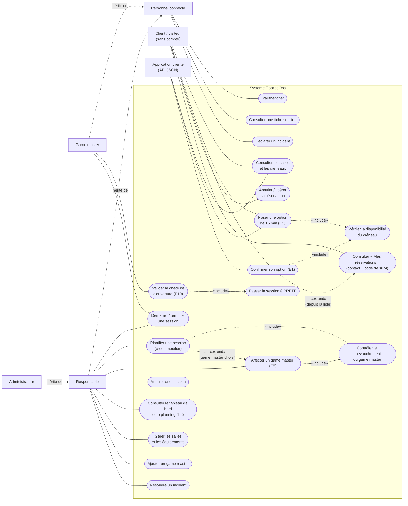

# Cas d'utilisation — EscapeOps

**Projet :** EscapeOps, outil de réservation et d'exploitation des Archives Obscures (client fictif)
**Règles contractuelles :** E1 (option de 15 minutes) · E5 (un game master ne peut pas se dédoubler) · E10 (checklist avant ouverture)
**Sources :** [CAHIER_DES_CHARGES.md](../CAHIER_DES_CHARGES.md), [CHOIX_REGLES.md](../CHOIX_REGLES.md), [BACKLOG.md](../BACKLOG.md), [starter-kit/README.md](../starter-kit/README.md), [starter-kit/docs/API.md](../starter-kit/docs/API.md), et le code : `starter-kit/routes/`, `starter-kit/src/`.

Ce document décrit **uniquement ce qui est implémenté** dans le code livré. Les extensions réservées (E2, E6, E9) ne sont pas réalisées et n'y figurent pas.

---

## 1. Acteurs

| Acteur | Accès | Droits (vérifiés côté serveur) |
|---|---|---|
| **Client / visiteur** | Sans compte. Il est reconnu par le **lien secret** de sa réservation (jeton de 32 caractères hexadécimaux) ou, sur « Mes réservations », par son **contact** et son **code de suivi** (8 caractères). | Consulter les salles et les créneaux, poser une option de 15 minutes, la confirmer ou l'annuler, retrouver ses réservations. Aucun accès à `/espace` ni à `/gestion`. |
| **Game master** | Compte, rôle `GAME_MASTER`. Accès à `/espace` (403 sur `/gestion`). | Consulter ses sessions et les fiches session, remplir la checklist d'ouverture **des sessions qui lui sont affectées**, démarrer et terminer ces sessions, déclarer un incident. |
| **Responsable** | Compte, rôle `RESPONSABLE`. Accès à `/espace` et `/gestion`. | Tout ce qui touche au planning : créer et modifier les sessions, affecter un game master, annuler une session, démarrer ou terminer une session. Il gère aussi les salles et les équipements, ajoute des game masters, résout les incidents et consulte le tableau de bord. Il ne remplit **pas** la checklist (403). |
| **Administrateur** | Compte, rôle `ADMIN`. | Dans le code, il a **les mêmes droits que le responsable** (`Authorization::PLANNING_MANAGERS`, `ROOM_MANAGERS`, `GAME_MASTER_RECRUITERS`). Aucune action ne lui est réservée. |
| **Application cliente (API)** | Acteur secondaire : un programme qui appelle l'API JSON `/api`. Il est anonyme pour les routes publiques. Pour `POST /api/incidents`, il doit présenter la session d'un membre du personnel. | Mêmes services que le site, donc mêmes règles et mêmes refus (US-54). |

Le responsable et le game master sont deux spécialisations du **personnel connecté**, qui partage la connexion, la fiche session et la déclaration d'incident. L'administrateur hérite des droits du responsable.

Les droits sont décidés dans une seule classe, `App\Domain\Authorization`. Ils sont contrôlés deux fois :
- par le middleware `RequireRole` sur les groupes de routes. Sans connexion, il redirige vers `/connexion` (302) ou renvoie 401 en API ; avec un rôle insuffisant, il renvoie 403 ;
- par les services, avant chaque écriture (US-13), qui lèvent `AccessDeniedException` (403).

Tout `POST` HTML sans jeton CSRF valide est également refusé (403, `CsrfMiddleware`).

---

## 2. Diagramme des cas d'utilisation

Lecture :
- **«include»** : le cas inclus est toujours exécuté. Ainsi, valider la checklist 3/3 tente systématiquement le passage à `PRETE`, et affecter un game master déclenche toujours le contrôle E5 du chevauchement.
- **«extend»** : comportement optionnel. Le choix d'un game master dans le formulaire de planification réalise l'affectation, mais il reste facultatif (US-35). Depuis « Mes réservations », le client peut ouvrir une option en cours pour la confirmer.
- `PRETE` n'est pas proposé en bouton sur la fiche. On y arrive par la checklist. Un `POST /espace/sessions/{id}/etat` forgé avec `etat=PRETE` passe par les mêmes contrôles et il est refusé s'ils échouent.

---

## 3. Tableau récapitulatif

| # | Cas d'utilisation | Acteur(s) | Route(s) HTML / endpoint(s) API | Règle(s) |
|---|---|---|---|---|
| UC1 | Consulter les salles et les créneaux | Client, API | `GET /`, `GET /salles/{id}` · `GET /api/rooms`, `GET /api/rooms/{id}`, `GET /api/sessions?roomId=&date=` | US-20, disponibilité calculée à l'instant (E1) |
| UC2 | Poser une option de 15 minutes | Client, API | `GET` et `POST /sessions/{id}/reserver` · `POST /api/reservations` | **E1** (US-30, US-31), invariants US-23 |
| UC3 | Confirmer son option | Client, API | `GET /reservations/{jeton}`, `POST /reservations/{jeton}/confirmer` · `GET /api/reservations/{jeton}`, `POST /api/reservations/{jeton}/confirmation` | **E1** (US-32, US-33) |
| UC4 | Annuler / libérer sa réservation | Client | `POST /reservations/{jeton}/annuler` (pas d'équivalent API) | E1 : le créneau est libéré tout de suite |
| UC5 | Consulter « Mes réservations » | Client | `GET /mes-reservations`, `POST /mes-reservations/connexion`, `POST /mes-reservations/deconnexion` | US-101, US-102 |
| INC1 | Vérifier la disponibilité du créneau | (inclus) | `SlotAvailability::of()` | E1, invariants du socle |
| UC6 | S'authentifier | Personnel | `GET` et `POST /connexion`, `POST /deconnexion` | US-10 (hachage, régénération de session, CSRF) |
| UC7 | Consulter une fiche session | Personnel | `GET /espace`, `GET /espace/sessions/{id}` | US-27, US-41 (historique des checklists) |
| UC8 | Déclarer un incident | Personnel, API | `GET /espace/incidents`, `GET /espace/incidents/nouveau`, `POST /espace/incidents` · `POST /api/incidents` | US-26, US-53 |
| UC9 | Valider la checklist d'ouverture | Game master affecté | `POST /espace/sessions/{id}/checklist` | **E10** (US-39, US-40) |
| UC10 | Passer la session à `PRETE` | (inclus dans UC9) | Appel interne `changeStatus(PRETE)`. Le `POST /espace/sessions/{id}/etat` forgé est contrôlé de la même façon | **E10**, EV-TEV-01 (game master obligatoire) |
| UC11 | Démarrer / terminer une session | Game master affecté, responsable | `POST /espace/sessions/{id}/etat` (`EN_COURS`, `TERMINEE`) | US-27, **E5** (US-37 : pas de démarrage sans game master) |
| UC12 | Planifier une session | Responsable | `GET /gestion/sessions/nouvelle`, `POST /gestion/sessions`, `GET /gestion/sessions/{id}/modifier`, `POST /gestion/sessions/{id}` | US-22 (fin calculée, salle occupée, remise en état), **E5** |
| UC13 | Affecter un game master | Responsable | `POST /gestion/sessions/{id}/game-master` | **E5** (US-35, US-36), EV-TEV-01 |
| INC2 | Contrôler le chevauchement du game master | (inclus) | `SessionRepository::findGameMasterConflict()` | **E5** : `a.début < b.fin ET b.début < a.fin` |
| UC14 | Annuler une session | Responsable | `POST /espace/sessions/{id}/etat` (`ANNULEE`) | US-27 : réservée au responsable. Le groupe confirmé est marqué « à recontacter » |
| UC15 | Consulter le tableau de bord et le planning filtré | Responsable | `GET /gestion`, `GET /gestion/sessions?salle=&date=&etat=` | US-28, US-29, vues `v_planning_detaille` et `v_dashboard_exploitation` |
| UC16 | Gérer les salles et les équipements | Responsable | `/gestion/salles` (liste, création, fiche, modification, suppression), `POST /gestion/salles/{id}/equipements`, `POST …/equipements/{eq}/retirer`, `GET` et `POST /gestion/equipements` | US-21, US-25. Procédure `sp_bilan_salle` affichée sur la fiche salle |
| UC17 | Ajouter un game master | Responsable | `GET /gestion/game-masters`, `GET /gestion/game-masters/{id}`, `GET /gestion/game-masters/nouveau`, `POST /gestion/game-masters` | US-24, US-100 (le rôle est toujours `GAME_MASTER`) |
| UC18 | Résoudre un incident | Responsable | `POST /gestion/incidents/{id}/resoudre` | US-26 |

Les cas du responsable sont aussi ouverts à l'administrateur.

---

## 4. Fiches détaillées

### Fiche 1 — UC2 : Poser une option de réservation (E1)

| | |
|---|---|
| **Acteur principal** | Client / visiteur (ou application cliente via l'API) |
| **Objectif** | Bloquer un créneau pendant 15 minutes, le temps de confirmer |
| **Routes** | `GET` et `POST /sessions/{id}/reserver` · `POST /api/reservations` |
| **Code** | `ReservationController::reserve()` → `ReservationService::placeOption()` → `SlotAvailability`, `ReservationOption` |

**Préconditions**
- La session existe, elle commence dans le futur et elle est à l'état `PREVUE` ou `PRETE`.
- La session n'a aucune réservation `CONFIRMEE` et aucune option `EN_ATTENTE` encore valide.

**Scénario nominal**
1. Le client ouvre la fiche d'une salle (`GET /salles/{id}`). Chaque créneau affiche sa disponibilité et les créneaux libres proposent un bouton « Réserver ».
2. Il clique sur « Réserver » (`GET /sessions/{id}/reserver`). Le formulaire rappelle le créneau et la capacité de la salle.
3. Il saisit le nom du groupe, un contact (e-mail ou téléphone) et le nombre de joueurs, puis il valide (`POST`, avec le jeton CSRF).
4. Le système ouvre une transaction et verrouille la ligne de la session (`SELECT … FOR UPDATE`).
5. Le système recalcule la disponibilité à l'heure courante (horloge injectable `Clock`) et obtient `LIBRE`.
6. Le système valide les champs : nom non vide et de 100 caractères au plus, contact valide, nombre de joueurs compris entre la capacité minimale et la capacité maximale.
7. Le système enregistre la réservation avec le statut `EN_ATTENTE`, `date_expiration = maintenant + 15 min`, un jeton secret de 32 caractères hexadécimaux et un code de suivi de 8 caractères. Il valide ensuite la transaction.
8. Le système redirige le client (303) vers sa page de suivi `/reservations/{jeton}`. Le message affiché est « Option posée pour … jusqu'à HH h MM. […] Votre code de suivi : … ».

**Scénarios alternatifs et d'erreur**

| Étape | Situation | Réponse |
|---|---|---|
| 5 | Le créneau est en option pour un autre groupe (`EN_OPTION`) | **409**. Formulaire réaffiché : « Ce créneau est en option jusqu'à HH h MM : réessayez après cette heure […] » |
| 5 | Le créneau est déjà confirmé (`COMPLET`) | **409** : « Ce créneau est déjà réservé par un autre groupe. » |
| 5 | La session est passée, annulée ou déjà commencée (`FERME`) | **409** : « Ce créneau n'est plus réservable : il est passé ou a été annulé. » |
| 5 | Deux groupes valident à la même seconde | Le verrou fait passer les requêtes l'une après l'autre. Le second groupe voit l'option du premier et reçoit **409** |
| 6 | Champ vide ou invalide, ou nombre de joueurs hors capacité | **422**. Formulaire réaffiché avec une erreur par champ (par exemple « Cette salle accueille de 2 à 6 joueurs. ») |
| 4 | Session inconnue | **404** « Créneau introuvable » |
| 3 | Jeton CSRF absent ou faux | **403** |
| API | Réussite | **201** + en-tête `Location: /api/reservations/{jeton}`. Le corps contient `jeton`, `codeSuivi`, `statut: EN_ATTENTE` et `expiration` |
| API | Créneau indisponible | **409** `SLOT_UNAVAILABLE`, avec `disponibilite` (`EN_OPTION`, `COMPLET` ou `FERME`) |
| API | Données invalides, `sessionId` absent ou non entier | **422** `VALIDATION_ERROR`, avec `details` par champ |
| API | Session inconnue · mauvais `Content-Type` · JSON mal formé | **404** `SESSION_NOT_FOUND` · **415** · **400** |

**Suite : UC3, confirmer l'option** (`POST /reservations/{jeton}/confirmer`, `POST /api/reservations/{jeton}/confirmation`)
- Si l'option court encore et que la session est toujours réservable, la réservation passe à `CONFIRMEE` (303 vers la page de suivi ; 200 en API).
- Après 15 minutes, l'option est expirée. On a `maintenant ≥ date_expiration`, recalculé à chaque requête et sans tâche planifiée. La réponse est **409** « Votre option a expiré à HH h MM […] » (API : `OPTION_EXPIRED`). En base, la ligne reste `EN_ATTENTE` et le créneau redevient `LIBRE` pour les autres groupes.
- Si la réservation est déjà confirmée, si elle est annulée, ou si la session a été annulée ou a commencé entre-temps : **409** (API : `RESERVATION_CONFLICT`, avec `etat`).
- Si le jeton est inconnu : **404**.

**Postconditions**
- Succès : une réservation `EN_ATTENTE` existe. Le créneau s'affiche « en option jusqu'à … » sur la vitrine et dans l'API pendant 15 minutes. Le client dispose de son lien secret et de son code de suivi.
- Échec : rien n'est enregistré et la disponibilité du créneau ne change pas.

---

### Fiche 2 — UC13 : Affecter un game master à une session (E5)

| | |
|---|---|
| **Acteur principal** | Responsable (ou administrateur) |
| **Objectif** | Attribuer un animateur à une session sans qu'il soit prévu sur deux sessions qui se chevauchent |
| **Routes** | `POST /gestion/sessions/{id}/game-master` (depuis la fiche session). Le même contrôle s'applique à `POST /gestion/sessions` (création) et à `POST /gestion/sessions/{id}` (modification) |
| **Code** | `SessionController::assignGameMaster()` → `SessionService::assignGameMaster()` → `gameMasterConflict()` → `SessionRepository::findGameMasterConflict()` |

**Préconditions**
- Le responsable ou l'administrateur est connecté.
- La session existe et elle est à l'état `PREVUE` ou `PRETE` : la partie n'a pas commencé.

**Scénario nominal**
1. Le responsable ouvre la fiche session (`GET /espace/sessions/{id}`). Le formulaire d'affectation s'affiche, avec la liste des comptes `GAME_MASTER`.
2. Il choisit un game master et valide (`POST`, avec le jeton CSRF).
3. Le système vérifie le droit (`Authorization::denyUnlessCanManagePlanning`).
4. Le système vérifie que la session existe et que son état permet l'affectation.
5. Le système vérifie que l'identifiant désigne bien un compte de rôle `GAME_MASTER`.
6. Le système cherche une autre session non annulée du même game master qui chevauche celle-ci. La condition est `s.date_debut < fin ET début < s.date_fin`. La session elle-même est exclue. Il n'en trouve aucune.
7. Le système enregistre l'affectation, sans changer l'état de la session.
8. Le système redirige (303) vers la fiche, avec le message « Game master affecté. »

**Scénarios alternatifs et d'erreur**

| Étape | Situation | Réponse |
|---|---|---|
| 6 | Le game master anime déjà une session qui chevauche (par exemple Camille à 18 h en salle 1, puis demandée à 18 h 30 en salle 3) | **422**. Fiche réaffichée : « Camille Leroy anime déjà « … » le … jusqu'à … : les deux créneaux se chevauchent. » L'affectation n'est pas faite |
| 6 | Les créneaux sont jointifs (fin de l'une = début de l'autre) | Accepté : les comparaisons sont strictes |
| 6 | L'autre session du game master est `ANNULEE` | Pas de conflit : une session annulée libère le game master |
| 5 | Identifiant inconnu, ou compte qui n'est pas un game master | **422** « Choisissez un game master existant, ou aucun. » |
| 4 | La session est `EN_COURS`, `TERMINEE` ou `ANNULEE` | **422** « Le game master ne change plus sur une session « … ». » |
| 4 | Session inconnue | **404** |
| 2 | Le responsable choisit « aucun » (valeur vide) | Le game master est retiré. Si la session était `PRETE`, elle repasse à `PREVUE` (évolution EV-TEV-01) avec le message « […] la session n'est plus prête et repasse à « Prévue » (personnel manquant) ». Les réservations sont conservées |
| 7 | La session a changé d'état entre la lecture et l'écriture | **422** « La session a changé d'état entre-temps : rechargez la fiche. » |
| 3 | Un game master connecté envoie la requête | **403** (middleware `/gestion`, puis contrôle dans le service) |
| 3 | Personne n'est connecté | 302 vers `/connexion` |
| 2 | Jeton CSRF absent ou faux | **403** |

**Règle E5 liée : démarrer une session.** Un `POST /espace/sessions/{id}/etat` avec `etat=EN_COURS` sur une session sans game master est refusé : **422** « Impossible de démarrer la partie : aucun game master affecté à cette session. » Le refus vaut même pour une requête forgée.

**Postconditions**
- Succès : la session a un game master et ce game master n'a aucune autre session non annulée qui la chevauche.
- Échec : la session et son game master restent inchangés.

---

### Fiche 3 — UC9 + UC10 : Valider la checklist d'ouverture et passer la session à `PRETE` (E10)

| | |
|---|---|
| **Acteur principal** | Game master **affecté** à la session |
| **Objectif** | Attester que la salle est prête et ouvrir la session aux joueurs |
| **Routes** | `POST /espace/sessions/{id}/checklist`. Contrôle également appliqué à `POST /espace/sessions/{id}/etat` avec `etat=PRETE` (requête forgée) |
| **Code** | `SessionController::checklist()` → `SessionService::submitChecklist()` → `OpeningChecklist`, puis `SessionService::changeStatus(PRETE)` |

**Préconditions**
- Le game master est connecté et il est affecté à la session (`id_game_master` = son identifiant).
- La session est à l'état `PREVUE`.

**Scénario nominal**
1. Le game master ouvre la fiche de sa session depuis `/espace`. Le formulaire présente trois cases : « Salle rangée », « Matériel testé », « Consignes de sécurité vérifiées ».
2. Il coche les trois cases et valide (`POST`, avec le jeton CSRF).
3. Le système vérifie que la session existe et que l'utilisateur est le game master affecté (`Authorization::denyUnlessCanFillChecklist`).
4. Le système vérifie que la session est `PREVUE`.
5. Le système lit les cases. Seules les valeurs « 1 » ou « on » valent « oui » : une case absente ou une autre valeur vaut « non ».
6. Le système enregistre **toujours** la checklist : session, game master, les trois valeurs et la date.
7. La checklist est complète (3/3). Le système demande donc le passage à `PRETE` et revérifie :
   - le droit ;
   - que la transition `PREVUE → PRETE` est permise ;
   - que la dernière checklist enregistrée est 3/3 ;
   - qu'un game master admissible est affecté : un compte de rôle `GAME_MASTER`, sans conflit E5.
8. La session passe à `PRETE`. Le trigger `trg_session_history` inscrit le changement dans `historique_session`.
9. Le système redirige (303) vers la fiche, avec le message « Checklist 3/3 enregistrée : la session est prête. » La checklist apparaît dans l'historique de la fiche, de la plus récente à la plus ancienne.

**Scénarios alternatifs et d'erreur**

| Étape | Situation | Réponse |
|---|---|---|
| 7 | Checklist incomplète (par exemple 2/3) | **422**. La checklist est **enregistrée**, mais la session reste `PREVUE` : « Salle non prête : checklist 2/3. Point(s) à valider : … » |
| 3 | Un autre game master, le responsable ou l'administrateur envoie la checklist | **403** « Seul le game master affecté à cette session peut remplir sa checklist d'ouverture. » |
| 4 | La session n'est pas `PREVUE` (déjà prête, en cours…) | **422** « La checklist se remplit sur une session « prévue » (état actuel : …). » |
| — | `POST /espace/sessions/{id}/etat` forgé avec `etat=PRETE`, sans checklist 3/3 | **422** « Salle non prête : … ». Le refus vaut même pour l'administrateur |
| 7 | Checklist 3/3 déjà enregistrée, mais plus aucun game master affecté (`etat=PRETE` forgé) | **422** « Salle non prête : aucun game master affecté. Une checklist ne remplace pas un animateur. » (EV-TEV-01) |
| 3 | Session inconnue | **404** |
| 2 | Jeton CSRF absent ou faux · personne de connecté | **403** · 302 vers `/connexion` |

**Postconditions**
- Succès : une checklist 3/3 est enregistrée, la session est `PRETE` et le changement d'état est historisé.
- Échec à 2/3 : la checklist incomplète est conservée pour la traçabilité et la session reste `PREVUE`.
- Échec sur les droits ou l'état : rien n'est enregistré.

---

### Fiche 4 — UC5 : Consulter « Mes réservations » par code de suivi

| | |
|---|---|
| **Acteur principal** | Client / visiteur (sans compte) |
| **Objectif** | Retrouver ses parties à venir et son historique sans créer de compte |
| **Routes** | `GET /mes-reservations`, `POST /mes-reservations/connexion`, `POST /mes-reservations/deconnexion` |
| **Code** | `ClientController` → `ClientAccessService` → `TrackingCode`, `ClientHistory`, `Security\ClientAccess` |

**Préconditions**
- Le client a déjà posé au moins une option (UC2) et il a noté son code de suivi, affiché à la pose et sur la page de suivi.
- Il n'a pas accumulé 5 échecs de connexion dans les 15 dernières minutes.

**Scénario nominal**
1. Le client ouvre `/mes-reservations`. Comme il n'est pas encore reconnu, le formulaire « contact + code de suivi » s'affiche.
2. Il saisit le contact (e-mail ou téléphone) utilisé lors de la réservation et son code de suivi, puis il valide (`POST /mes-reservations/connexion`, avec le jeton CSRF).
3. Le système normalise les deux valeurs :
   - contact : e-mail en minuscules, espaces et points retirés du téléphone ;
   - code : 8 caractères pris dans un alphabet sans caractères ambigus.
4. Le système cherche une réservation qui correspond à la fois à ce code et à ce contact. Il la trouve.
5. Le système régénère l'identifiant de session PHP, contre la fixation de session. Il mémorise ensuite le contact reconnu, dans un espace séparé de celui du personnel.
6. Le système redirige (303) vers `/mes-reservations`. La page liste les réservations de ce contact, avec leur état calculé à l'instant (option en cours, expirée, confirmée, annulée). Elles sont réparties en deux groupes :
   - **à venir** : la plus proche d'abord ;
   - **historique** : la plus récente d'abord, avec le résultat de chaque partie et le nombre de parties jouées.
7. Depuis une option en cours, le client peut suivre le lien « Confirmer ou libérer » vers `/reservations/{jeton}` (UC3, UC4).
8. Le client clique sur « Quitter » (`POST /mes-reservations/deconnexion`). Le système oublie le contact et régénère la session.

**Scénarios alternatifs et d'erreur**

| Étape | Situation | Réponse |
|---|---|---|
| 4 | Contact inconnu, code faux, ou code d'un autre contact | **422** avec **le même message** dans tous les cas : « Aucune réservation ne correspond à ce contact et à ce code. […] ». On ne révèle pas quels contacts existent. L'échec est compté |
| 3 | Code mal formé (longueur, caractères) | **422**, même message |
| 2 | 5 échecs ou plus dans les 15 dernières minutes | **429** « Trop de tentatives : réessayez dans un quart d'heure. » |
| 6 | Aucune partie à venir | Message « Aucune partie prévue », avec un lien vers la vitrine |
| — | Un client reconnu tente d'ouvrir `/espace` ou `/gestion` | Cet accès ne donne aucun droit : il est redirigé vers `/connexion` |
| 2 | Jeton CSRF absent ou faux | **403** |

**Postconditions**
- Succès : le client voit uniquement les réservations rattachées à son contact. Les pages sont servies avec `Cache-Control: no-store` et `Referrer-Policy: no-referrer`, car elles contiennent les liens secrets.
- Échec : aucune information n'est divulguée et le compteur d'échecs augmente.

---

## 5. Écarts constatés entre la documentation et le code

| Point | Cahier des charges / documentation | Code livré |
|---|---|---|
| Administrateur | § 3 : « Gérer les comptes, les salles et les équipements, avec en plus tous les droits du responsable » | Aucune action réservée à l'admin : il a exactement les droits du responsable. La gestion des comptes se limite à l'ajout de comptes `GAME_MASTER` (US-100), ouvert aussi au responsable. Il n'existe ni modification ni suppression de compte |
| Responsable : « gérer les réservations » | § 3 | Aucun écran de gestion des réservations par le personnel. Les réservations sont visibles, avec leurs contacts, sur la fiche session. Le responsable n'agit sur elles qu'indirectement : en annulant une session, il fait passer le groupe confirmé « à recontacter ». Confirmer ou annuler une réservation se fait uniquement par le client, via son lien secret |
| Refus E5 | Cahier des charges § 9, point 5 : « 409 pour un créneau en option » | Exact pour E1. Les refus E5 (chevauchement, démarrage sans game master) et E10 (checklist incomplète) renvoient en revanche **422**, et non 409. Ce choix est cohérent dans tout le code et le README le documente |
| Passage à `PRETE` | E10 : checklist 3/3 | Il faut en plus un game master admissible affecté (évolution EV-TEV-01). Ce point est documenté dans `starter-kit/docs/evolutions/EV-TEV-01.md` |
| `POST /api/incidents` : 403 | `docs/API.md` annonce un 403 `FORBIDDEN` (rôle insuffisant) | La route accepte les trois rôles du personnel (`Authorization::STAFF`) : le 403 est prévu par le middleware, mais il ne se produit pas en pratique |
| Annulation par l'API | — | L'API permet de poser, consulter et confirmer une option, mais pas de l'annuler. L'annulation n'existe que sur le site (`POST /reservations/{jeton}/annuler`) |
| État `INTERROMPUE` | Réservé à E6 | La constante existe dans `SessionStatus`, mais aucune transition n'y mène : E6 n'est pas réalisée |
| Commentaire obsolète | `SessionStatus.php` : « Demain : PRETE exigera la checklist 3/3 (E10) et EN_COURS un game master affecté (E5) » | Ces deux contrôles sont implémentés dans `SessionService::changeStatus()`. Le commentaire est à mettre à jour |
| Noms des colonnes | Cahier des charges § 5 et § 7 : `status`, `expires_at`, `session_history` | En base : `statut`, `date_expiration`, `historique_session` (MLD en français) |
